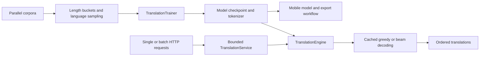

# Translation architecture and scaling

LingoLite keeps one portable encoder-decoder model for mobile and server use.
Training, translation orchestration, and HTTP scheduling are separate layers.
Existing checkpoints and default decoding behavior remain compatible. These
changes provide quality controls and bounded resource use; they do not establish
translation quality without a trained checkpoint and held-out evaluation data.



## Responsibilities

| Component | Responsibility |
| --- | --- |
| `mobile_translation_model.py`, `generation_utils.py` | Tensor computation, caches, beam search and shared decoding constraints; no server dependencies |
| `training.py` | Dataset encoding, deterministic batch planning, optimization and checkpointing |
| `inference.py` | Artifact compatibility checks, language validation, tokenization, source masks, batched generation and decoding |
| `serving.py` | Admission limits, compatible microbatches, deadlines, cancellation and worker lifecycle |
| `scripts/api_server.py` | HTTP schemas, status codes, startup configuration and health reporting |

The engine can be used directly in Python without FastAPI. It serializes access
to one model and tokenizer, including tokenization and decoding. The service
owns one dedicated inference thread. Incoming HTTP requests stay on the event
loop and allocate no GPU tensors until admitted work reaches the worker. This
follows FastAPI's separation of async request handling and blocking computation
([FastAPI concurrency documentation](https://fastapi.tiangolo.com/async/)).

## Translation behavior

`/translate` retains its response fields. `POST /translate/batch` accepts 1–64
texts with a shared language direction and generation options, and returns
`{"translations": [...]}` in input order:

```json
{
  "texts": ["Hello, world!", "Where is the station?"],
  "src_lang": "en",
  "tgt_lang": "es",
  "method": "beam",
  "num_beams": 4,
  "max_length": 128,
  "length_penalty": 1.0,
  "min_new_tokens": 0,
  "no_repeat_ngram_size": 0
}
```

All generation entry points support `min_new_tokens`, `no_repeat_ngram_size`,
and `suppress_tokens` (the last is Python-only). Defaults leave decoding
unconstrained. Minimum length counts generated tokens after SOS; `max_length`
includes SOS. Repetition blocking and suppression can exclude valid translations,
so tune them per language/domain and retain an unconstrained baseline. Impossible
constraints fail explicitly. Beam search also exposes `length_penalty` through
HTTP. Sampling temperature applies to greedy/fast generation, not beam search.

Inputs are encoded completely and rejected with HTTP 400 when they exceed the
smaller of the model's configured sequence limit and 512 tokens, including
language/control tokens. They are never silently truncated. Automatic splitting
is deliberately left to callers who can preserve sentence/document context.
Variable-length inputs are padded with an explicit attention mask. Results are
trimmed at each sequence's EOS, so output lengths exclude batch padding.

Each HTTP batch is admitted atomically: if it cannot fit, none of it is enqueued.
If any item is invalid, that batch request returns an error; valid items may have
already executed. Invalid input in one request does not fail other HTTP requests
sharing a microbatch. A model execution failure fails all members of that
microbatch, after which the worker continues accepting work.

## Bounded serving and replication

| Environment variable | Default | Meaning |
| --- | --- | --- |
| `LINGOLITE_MODEL_PATH` | `./models/translation_model.pt` | Checkpoint for this replica |
| `LINGOLITE_TOKENIZER_PATH` | `./tokenizer` | Matching tokenizer directory |
| `LINGOLITE_MAX_BATCH_SIZE` | `8` | Maximum texts in one model call |
| `LINGOLITE_MAX_PENDING` | `128` | Maximum outstanding texts, including active work |
| `LINGOLITE_MAX_BATCH_TOKENS` | `8192` | Conservative source + decode token budget per model call |
| `LINGOLITE_BATCH_WAIT_MS` | `5` | Coalescing window when the worker wakes |
| `LINGOLITE_REQUEST_TIMEOUT` | `30` | Seconds from admission to response, including queue time |

Compatible requests share all generation options; language directions can differ
because the tokenizer encodes each source/target language. The oldest queued
request determines the next batch's options. Matching queued requests fill that
batch, preserving result order through per-request futures. A backlog is drained
without inserting an additional wait between every batch.

The conservative cost per text is `source_limit + max_length * beam_count`
(`beam_count=1` outside beam search). The scheduler bounds both text count and
this token estimate. It is not a byte-level memory cap: model size, vocabulary
logits and attention lengths also affect memory. Tune limits on target hardware.

Queue saturation returns **429** with `Retry-After: 1`; invalid input or an
impossible single-request token budget returns **400**; deadline expiry returns
**504**; unavailable or shutting-down replicas return **503**. Cancellation and
timeouts discard queued work. Already-running tensor computation finishes and
continues occupying capacity until completion; it cannot be safely killed by
cancelling an HTTP request. Shutdown rejects waiting requests and waits for the
active model call. There is no durable job queue or automatic model retry.

Use `/health/liveness` for process checks and `/health/readiness` for routing
traffic. `/health` includes outstanding text count and completed model-batch
count (including batches with input errors); these are per-process counters,
not a full metrics backend.

For more capacity, run independent replicas behind a load balancer. Give each GPU
replica its own device allocation and matching immutable model/tokenizer bundle.
Multiple Uvicorn workers each load a full copy of the model; choose that count
from measured memory availability. CPU replicas should tune PyTorch/BLAS thread
counts to avoid oversubscription. Start mobile-oriented workloads with batch
size 1 and a zero coalescing window when interactive latency matters most.

Startup and cleanup use FastAPI's
[lifespan context](https://fastapi.tiangolo.com/advanced/events/) so the worker
and model are released together. The container starts the API and its health
check requires readiness. Mount
trained artifacts before starting it. The default Compose configuration provides
one local CPU replica; a load balancer and orchestration are separate deployment
choices. This change does not deploy infrastructure or train a model.

## Training at larger corpus sizes

Enable the new controls on the existing training command:

```text
--batch-size 64 --max-tokens 4096 --language-temperature 2 --pretokenize
```

`TranslationBatchSampler` groups similarly sized examples within shuffled pools.
`--batch-size` remains an example-count ceiling, and `--max-tokens` bounds
`examples * (longest_source + longest_target)` after padding. Without language
sampling every example appears once per epoch. Oversized individual examples
are rejected rather than violating the budget. Cached lengths are reused, and
pretokenization avoids repeated encoding. Plans are reproducible from seed and
epoch; the trainer advances the sampler each epoch.

`--language-temperature T` samples directed pairs with probability proportional
to `pair_count ** (1/T)`, with replacement. Each epoch draws the corpus's original
number of examples. `T=1` preserves corpus proportions in expectation; `T>1`
gives smaller pairs more exposure. This can improve balance but also oversample
noise. Track BLEU/chrF separately for every direction. Omitting both new options
retains the existing shuffled fixed-size loader.

Current limits: corpora and batch plans remain in host memory, training is
single-process, validation uses the existing fixed-size batches, and token
budgets are not strict device-memory limits. At larger scale, revisit streaming
shards, distributed sampling, per-token loss weighting across variable-size
gradient-accumulation steps, and checkpointed sampler progress for exact resume.

## Validation and next decisions

Regression tests cover decoding constraints, true-model batch/single equivalence,
padding masks, invalid input isolation, overload, deadlines, cancellation,
shutdown, HTTP integration, sampler coverage and deterministic language balance.

Before choosing a deployment size, measure throughput, p50/p95 latency, overload
rate and peak memory for real length distributions and beam settings on the
target CPU/GPU/mobile runtime. Compare greedy and beam BLEU/chrF, premature EOS,
repetition, named entities, and long-input behavior using the same held-out set.
The repository's multilingual evaluation scripts can establish that baseline.
Revisit request caching only with an explicit privacy/retention policy and model
version in the key; revisit a durable external queue for offline bulk jobs.
